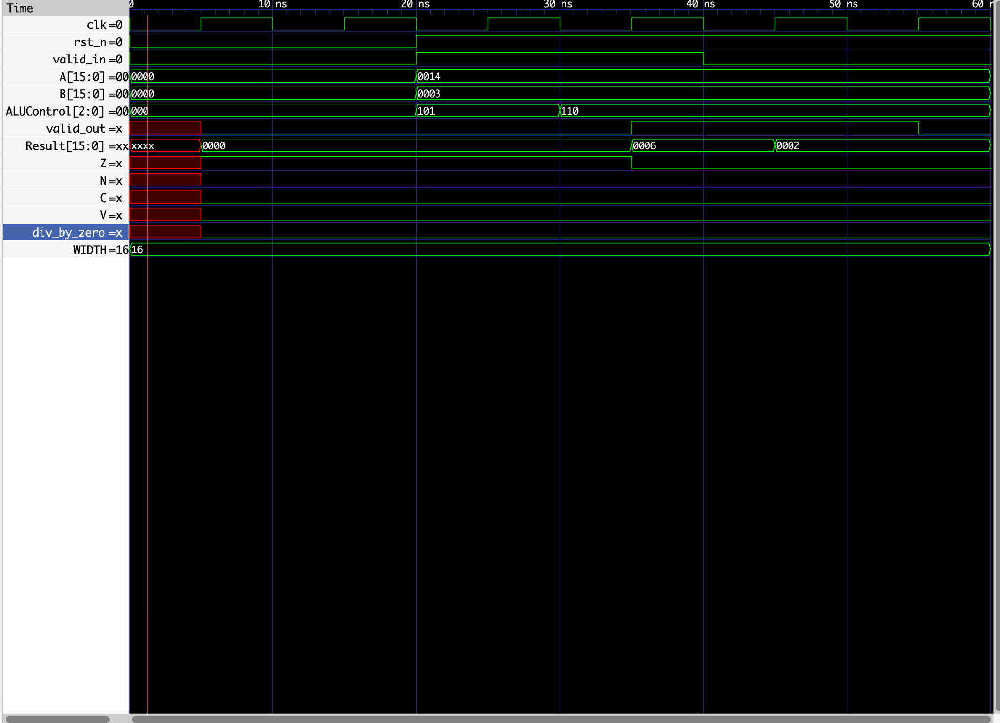
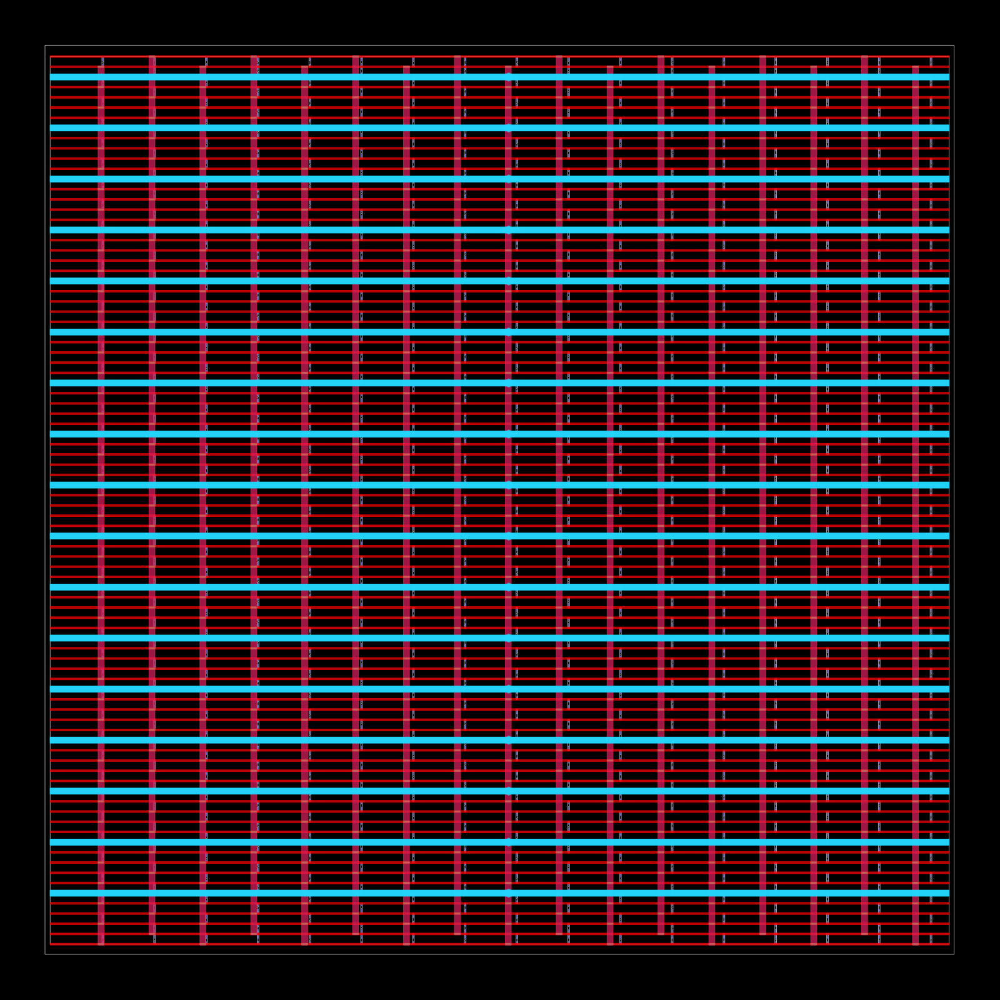
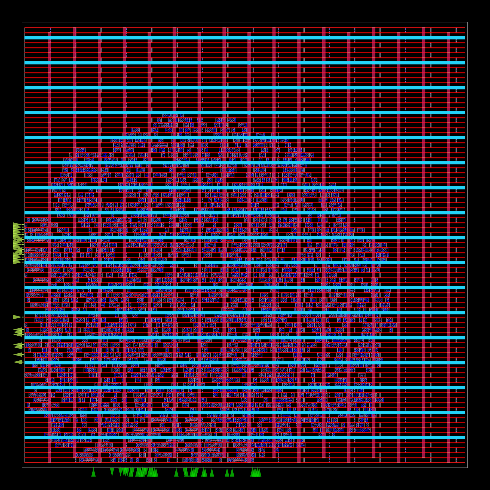
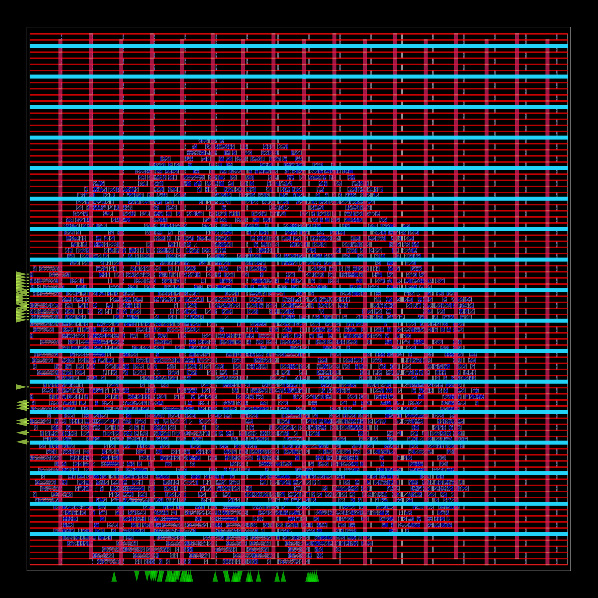
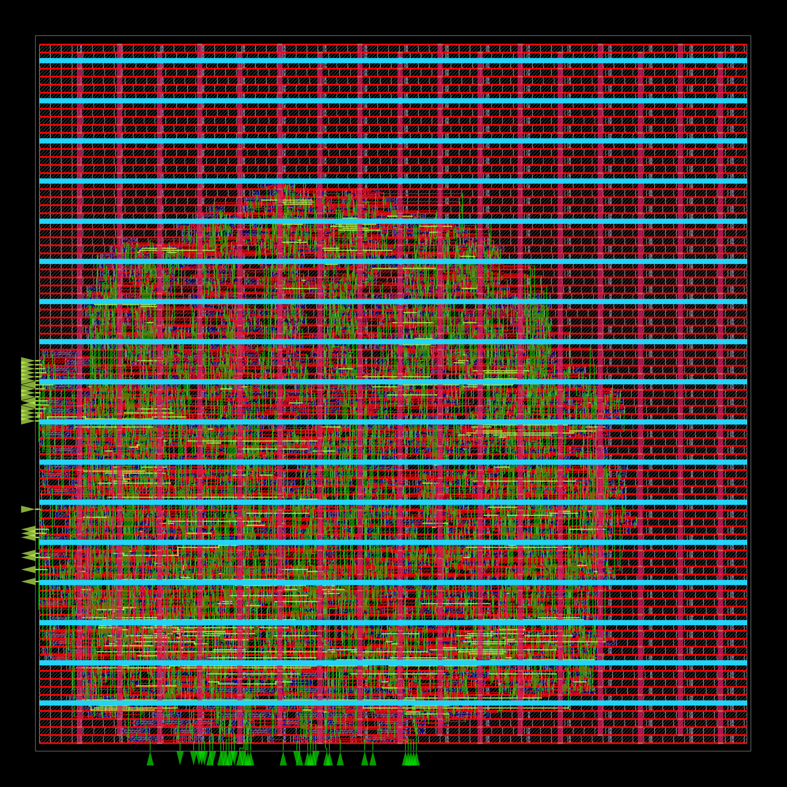
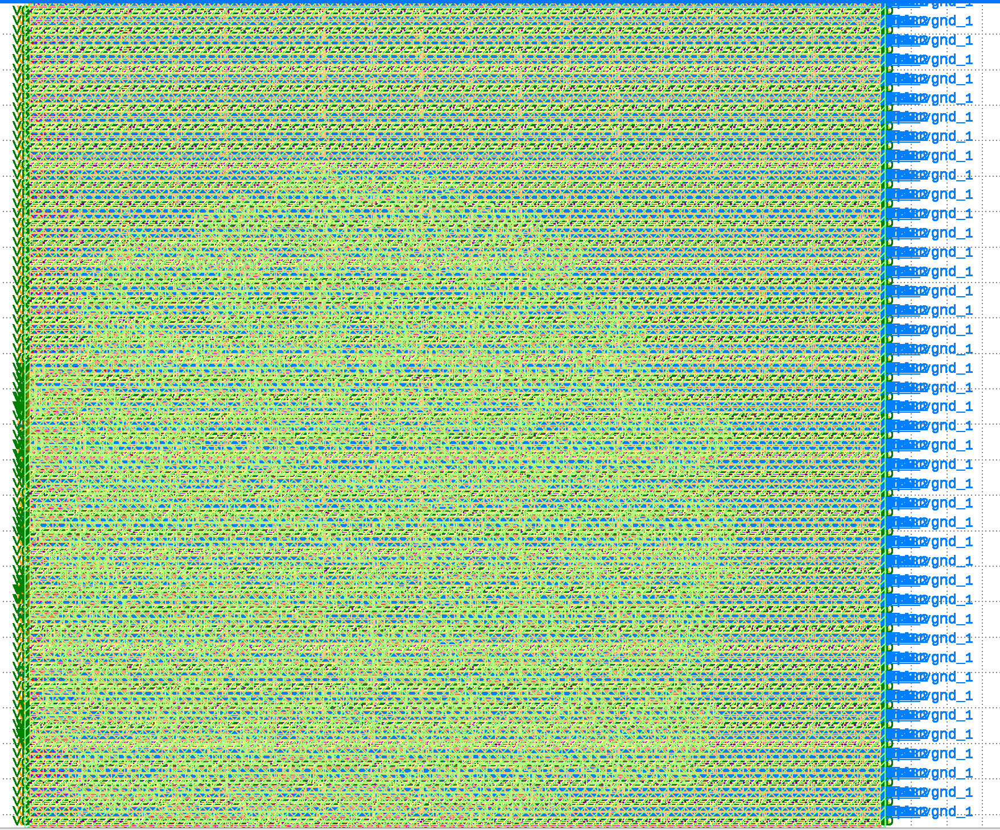
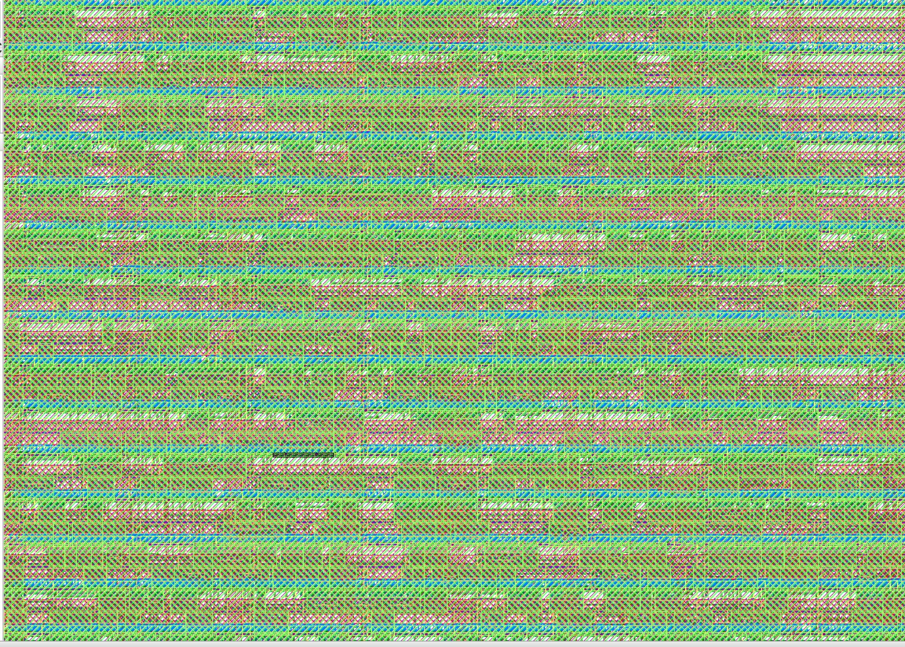
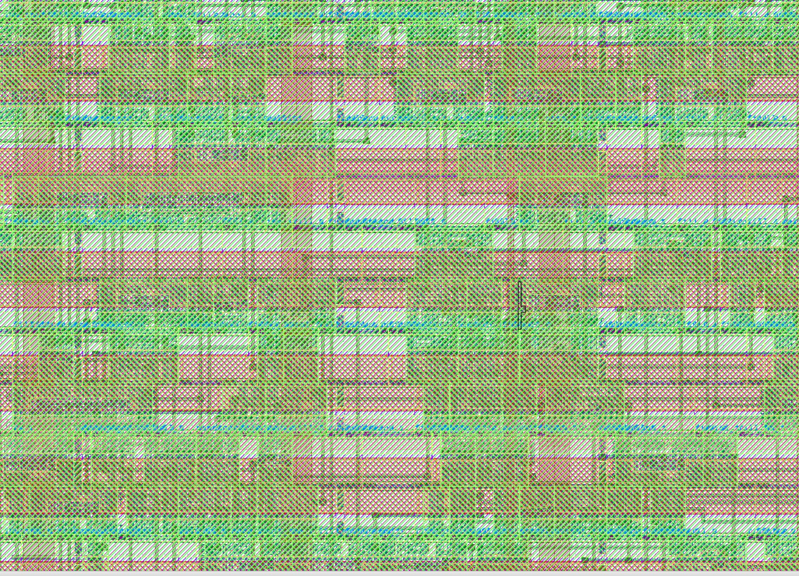
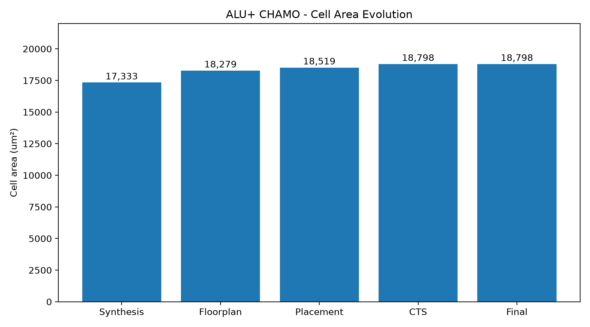
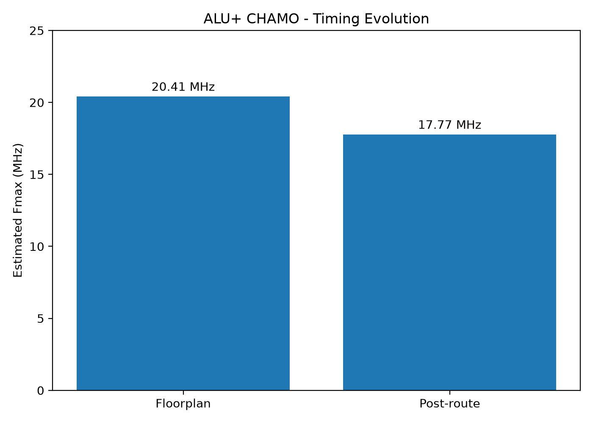

<div align="center">

# ALU+ CHAMO

### Diseño e implementación física de una ALU síncrona de 16 bits

**SystemVerilog · Verilator / Icarus Verilog · Yosys · OpenROAD · SKY130HD · KLayout**

*Del RTL al layout GDSII mediante un flujo de herramientas abiertas.*

</div>

---

## Descripción del proyecto

**ALU+ CHAMO** es un proyecto de diseño digital y flujo ASIC centrado en una unidad aritmético-lógica síncrona de **16 bits**. El trabajo abarca la descripción del hardware en SystemVerilog, la verificación funcional, la síntesis lógica, la planificación física, la colocación de celdas, la construcción del árbol de reloj, el enrutamiento y la generación del layout final.

El objetivo no es mostrar únicamente el circuito terminado, sino documentar **cómo evoluciona un diseño digital desde su comportamiento lógico hasta una implementación física verificable**.

## Resultados destacados

| Indicador | Resultado |
|:--|--:|
| Ancho de datos | 16 bits |
| Área de celdas tras síntesis ORFS | 17 332,87 µm² |
| Área de celdas al final de la implementación | ≈ 18 798 µm² |
| Período de reloj objetivo | 100 ns (10 MHz) |
| Slack de setup final | +43,74 ns |
| Slack de hold final | +0,35 ns |
| Período mínimo estimado tras routing | 56,26 ns |
| Frecuencia máxima estimada tras routing | 17,77 MHz |
| Violaciones finales de DRC | 0 |
| Comprobación LVS | Netlists coincidentes |

*Las cifras temporales son estimaciones de análisis estático para las condiciones y la esquina evaluadas; no representan una certificación de operación multicorner ni una medición en silicio.*

## 1. Arquitectura digital

El diseño incorpora un módulo de ALU combinacional y una envoltura síncrona con registros y control de validez. Sus bloques RTL incluyen:

- `rtl/alu_plus_sync.sv`: interfaz síncrona y registros de entrada/salida.
- `rtl/alu_plus.sv`: selección y ejecución de operaciones de la ALU.
- `rtl/cla_adder.sv`: sumador de anticipación de acarreo (*carry-lookahead adder*).
- `rtl/restoring_divider.sv`: divisor de tipo *restoring*.
- `rtl/tristate_demo.sv`: demostración RTL independiente de comportamiento triestado.

El módulo `tristate_demo.sv` se conserva como ejemplo didáctico; **no se incluye como parte de la implementación física de `alu_plus_16` documentada aquí**.

El wrapper de implementación física se encuentra en `physical/orfs/alu_plus_16.sv`.

## 2. Verificación funcional

El proyecto cuenta con pruebas funcionales dirigidas y aleatorias. En la regresión de 16 bits realizada previamente se registraron **1 656 comprobaciones satisfactorias**. La captura siguiente muestra específicamente la verificación síncrona de división y módulo.



**Figura 1.** Simulación funcional en GTKWave. Con `A = 20` y `B = 3`, el código de control `101` produce `Result = 6` (DIV) y `110` produce `Result = 2` (MOD). `valid_out` indica cuándo cada resultado registrado es válido.

La forma de onda permite observar el reloj, el reinicio, los operandos, la selección de operación, los resultados y las banderas. El período de reloj de esta **simulación funcional** es de 10 ns; no debe confundirse con la frecuencia máxima estimada en el diseño físico.

**Testbenches:** `tb/tb_alu_plus.sv` y `tb/tb_alu_plus_sync.sv`.

### Verificación de parametrización: 8, 16 y 32 bits

Para comprobar que el núcleo mantiene la misma arquitectura al cambiar el ancho de los buses, se ejecutó el testbench combinacional con **Verilator 5.053** para tres configuraciones de `WIDTH`. En cada una se aplicaron **1 656 vectores** sobre los ocho códigos de `ALUControl`, incluyendo casos dirigidos y aleatorios.

| Ancho (`WIDTH`) | Vectores verificados | Resultado |
|:--:|--:|:--:|
| 8 bits | 1 656 | **PASS** |
| 16 bits | 1 656 | **PASS** |
| 32 bits | 1 656 | **PASS** |
| **Total** | **4 968** | **Sin fallos reportados** |

Estas pruebas confirman que la **ALU combinacional parametrizada** superó los estímulos ejecutados en las tres configuraciones, sin modificar su arquitectura RTL. Para probarlas se generó una copia temporal de `tb/tb_alu_plus.sv` en la que `WIDTH` pasó de `localparam` a `parameter`; el archivo original y el RTL permanecieron intactos.

**Alcance:** el testbench reutiliza algunas constantes de 16 bits y no cubre exhaustivamente todos los patrones posibles de 32 bits. La implementación física y el testbench síncrono de DIV/MOD presentados en este repositorio corresponden a **16 bits**. Las simulaciones a 8 y 32 bits no constituyen una verificación física ni de timing de esas configuraciones.


## 3. Síntesis lógica

El RTL fue sintetizado y mapeado a celdas estándar de **SKY130HD** dentro de OpenROAD Flow Scripts (ORFS), que utiliza Yosys para la síntesis.

- **Área de celdas sintetizadas:** 17 332,87 µm².
- La implementación física agrega posteriormente celdas y ajustes necesarios para colocación, reloj y cumplimiento de restricciones.
- Los valores de la síntesis ORFS y los de cualquier experimento de síntesis independiente deben identificarse por separado: no necesariamente usan la misma configuración o el mismo mapeo.

## 4. Implementación física

La implementación se realizó mediante el flujo **RTL → síntesis → floorplan/PDN → placement → CTS → routing → GDSII**, con objetivo de reloj de 100 ns.

### 4.1 Floorplan y distribución de alimentación



**Figura 2.** Vista del diseño al finalizar la etapa de floorplan en ORFS. La captura contiene también las estructuras de alimentación (*PDN*) y las celdas físicas insertadas en esa etapa; por tanto, **no es una imagen del floorplan inicial vacío**.

### 4.2 Placement



**Figura 3.** Distribución de las celdas estándar dentro del núcleo del diseño, tras la colocación física.

### 4.3 Clock Tree Synthesis (CTS)



**Figura 4.** Estado del diseño después de la síntesis del árbol de reloj. El reporte registra **57 destinos de reloj (*sinks*) y 9 buffers de reloj**. La imagen muestra el estado físico general; **no es una visualización aislada de las ramas del árbol**.

### 4.4 Routing



**Figura 5.** Vista física después del enrutamiento. Se incorporan las conexiones metálicas de las redes de señal. La etapa de enrutamiento detallado terminó con **0 violaciones reportadas por el router**.

### 4.5 Layout final — GDSII

El diseño físico de **ALU+ CHAMO** culminó con la generación de un archivo **GDSII**, que representa la geometría física de la implementación, incluyendo capas de interconexión, estructuras de celdas estándar y conexiones del circuito.

El layout fue abierto e inspeccionado mediante **KLayout**, permitiendo examinar tanto la distribución global como los detalles de la implementación.

#### Vista general del layout y conexiones de entrada/salida



**Figura 6.** Vista general del GDSII en KLayout con capas físicas superpuestas y conexiones de entrada/salida visibles.

#### Detalle físico del diseño



**Figura 7.** Acercamiento al layout físico, donde se observan las estructuras repetitivas de las celdas estándar y las interconexiones entre diferentes capas.



**Figura 8.** Segunda vista detallada de las geometrías de interconexión y las estructuras internas del diseño físico.

Las imágenes muestran múltiples capas simultáneamente, por lo que algunas regiones presentan una alta densidad visual. Las capturas documentan la inspección del layout, mientras que el cumplimiento de reglas y la equivalencia de conectividad se sustentan en las verificaciones DRC y LVS.

### 4.6 Verificación física: DRC y LVS

Una vez completada la implementación, se realizaron verificaciones para comprobar el cumplimiento de las reglas geométricas y la correspondencia entre el layout y la netlist.

| Verificación | Resultado |
|:--|:--|
| GDSII | Generado correctamente |
| DRC (*Design Rule Check*) | 0 violaciones |
| LVS (*Layout Versus Schematic*) | Netlists coincidentes |
| Enrutamiento detallado | 0 violaciones finales del router |

El resultado **DRC = 0** indica que el verificador no encontró infracciones de las reglas aplicadas al layout durante esta ejecución.

El resultado **LVS satisfactorio** confirma que las netlists comparadas coinciden según la verificación realizada.

Estas comprobaciones validan los resultados de las herramientas y reglas utilizadas, pero **no equivalen a una certificación de fabricación de una fundición**.

## 5. Análisis de área y temporización

### 5.1 Evolución del área



**Figura 9.** Evolución del área de celdas estándar durante el flujo. El área pasa de **17 332,87 µm²** tras síntesis a aproximadamente **18 798 µm²** al finalizar la implementación, un aumento cercano al **8,45 %**.

Esta magnitud corresponde al área de celdas y **no debe confundirse con el área total del die**.

El incremento está asociado a las transformaciones realizadas durante la implementación física, incluida la inserción de celdas adicionales y los ajustes necesarios para el reloj y la colocación.

### 5.2 Evolución del timing



**Figura 10.** Comparación de la frecuencia máxima estimada entre **floorplan (20,41 MHz)** y **post-routing (17,77 MHz)**.

Esta comparación muestra la evolución temporal durante el diseño físico; **no representa una comparación directa entre timing de síntesis y timing de routing**.

| Medición | Floorplan | Post-routing |
|:--|--:|--:|
| Slack de setup | +51,01 ns | +43,74 ns |
| Período mínimo estimado | 48,99 ns | 56,26 ns |
| Frecuencia máxima estimada | 20,41 MHz | 17,77 MHz |

El cambio refleja el avance hacia una representación física más completa, con efectos de reloj y parasitismos de interconexión.

No se atribuye toda la variación a una sola causa sin un análisis detallado de cada contribución.

### 5.3 Análisis de la ruta crítica

El análisis estático de temporización (*Static Timing Analysis*, STA) permitió identificar la trayectoria más exigente después de la implementación física.

**Ruta crítica de setup:**

| Parámetro | Resultado |
|:--|:--|
| Registro de origen | `dut.b_q[0]` |
| Registro de destino | `dut.Z` |
| Data arrival time | 56,52 ns |
| Data required time | 100,26 ns |
| Slack de setup | +43,74 ns |

La ruta comienza en un registro correspondiente al operando `B`, atraviesa lógica combinacional sintetizada y termina en el registro de la bandera `Z`.

Este resultado demuestra que la generación de las banderas también puede influir significativamente en la frecuencia máxima, y que no necesariamente es una salida del bus `Result` la que determina la ruta crítica.

**Ruta más exigente de hold:**

| Parámetro | Resultado |
|:--|:--|
| Registro de origen | `dut.valid_q` |
| Registro de destino | `dut.valid_out` |
| Slack de hold | +0,35 ns |

Ambos márgenes fueron positivos en las condiciones analizadas.

### 5.4 Interpretación de los resultados

El diseño fue configurado para un período de reloj de **100 ns**, equivalente a **10 MHz**.

El período mínimo estimado tras routing fue de **56,26 ns**, equivalente a una frecuencia aproximada de **17,77 MHz** en la esquina temporal evaluada.

Esto indica que el circuito cumple la restricción de setup de 100 ns bajo las condiciones del análisis realizado.

Sin embargo, el resultado no debe interpretarse como una frecuencia garantizada para todas las variaciones de proceso, voltaje y temperatura.

## 6. Herramientas y metodología

| Área | Herramienta |
|:--|:--|
| Diseño RTL | SystemVerilog |
| Simulación y verificación | Verilator, Icarus Verilog, GTKWave |
| Síntesis | Yosys / ORFS |
| Implementación física | OpenROAD / ORFS |
| Análisis estático temporal | OpenROAD |
| Biblioteca de celdas estándar | SKY130HD |
| Inspección del layout | KLayout |
| Automatización | Shell y Python |
| Visualización de métricas | Matplotlib |
| Entorno de ejecución | macOS ARM64 |
| Ejecución del flujo físico | Docker `linux/amd64` |

El flujo implementado utiliza herramientas abiertas. Aunque el trabajo contempla conceptos y etapas comunes a los flujos industriales de Synopsys, **los resultados documentados aquí proceden de Yosys, OpenROAD y KLayout**, y no de ejecuciones de Design Compiler o ICC2.

## 7. Organización del repositorio

```text
ALUplus_Chamo/
│
├── README.md
│
├── rtl/
│   ├── alu_plus.sv
│   ├── alu_plus_sync.sv
│   ├── cla_adder.sv
│   ├── restoring_divider.sv
│   └── tristate_demo.sv
│
├── tb/
│   ├── tb_alu_plus.sv
│   └── tb_alu_plus_sync.sv
│
├── physical/
│   └── orfs/
│       ├── config.mk
│       └── constraint.sdc
│
└── docs/
    ├── charts/
    │   ├── area_evolution.png
    │   ├── timing_evolution.png
    │   └── generate_charts.py
    │
    └── screenshots/
        ├── 01_simulation/
        │   └── div_mod_waveform.png
        ├── 03_floorplan/
        │   └── floorplan.png
        ├── 05_placement/
        │   └── placement.png
        ├── 06_cts/
        │   └── cts.png
        ├── 07_routing/
        │   └── routing.png
        └── 08_gds_drc_lvs/
            ├── gds_full_with_pins.png
            ├── gds_detail_01.png
            └── gds_detail_02.png
```

Los reportes extensos, las bases de datos intermedias de implementación y los archivos temporales permanecen almacenados localmente como respaldo de ingeniería.

El repositorio público prioriza el código fuente, las configuraciones técnicas, las métricas verificadas y las evidencias visuales.

## 8. Conclusiones y próximos pasos

El desarrollo de **ALU+ CHAMO** permitió completar un flujo de diseño ASIC basado en herramientas abiertas, desde la descripción RTL hasta la generación de un layout GDSII inspeccionado en KLayout.

A través de la verificación funcional se comprobó el comportamiento de las operaciones aritméticas implementadas, mientras que la síntesis y las etapas físicas permitieron evaluar cómo el diseño lógico se transforma en una distribución de celdas e interconexiones reales.

Entre los resultados más importantes se encuentran:

- **Área final de celdas:** aproximadamente 18 798 µm².
- **Frecuencia máxima estimada post-routing:** 17,77 MHz.
- **Slack de setup:** +43,74 ns para el reloj objetivo de 10 MHz.
- **Verificación DRC:** 0 violaciones reportadas.
- **Verificación LVS:** correspondencia satisfactoria entre netlists.

El análisis temporal también permitió identificar que la ruta crítica comienza en `b_q[0]` y termina en la bandera `Z`, destacando la importancia de considerar tanto las unidades aritméticas como la lógica de estado durante la optimización.

Como posibles mejoras, se plantea estudiar alternativas de implementación para la división, optimizar las rutas de generación de banderas y ampliar el análisis estático a diferentes condiciones de proceso, voltaje y temperatura.

En conjunto, el proyecto constituye una experiencia práctica de **diseño RTL, verificación digital, síntesis y diseño físico de circuitos integrados**, documentando tanto los resultados obtenidos como las limitaciones de la implementación.

---

<div align="center">

**ALU+ CHAMO · Portafolio de diseño digital y flujo ASIC**

</div>
