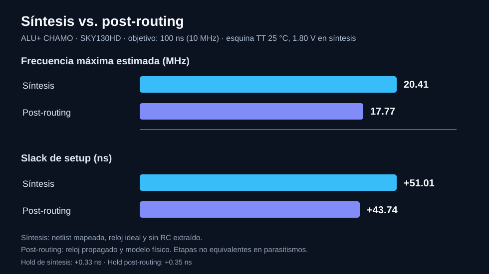

# Informe técnico de verificación — ALU+ CHAMO

**Diseño:** ALU+ de 16 bits, SystemVerilog, SKY130HD y OpenROAD Flow Scripts (ORFS).

**Alcance:** informe de resultados de diseño y procedimientos reproducibles de verificación. Se distinguen mediciones de implementación, análisis de código y verificaciones temporales que requieren ejecutarse sobre la biblioteca objetivo. Los reportes completos de OpenROAD se conservan localmente; el repositorio público incluye artefactos finales y capturas, pero no logs de ejecución.

## 1. Descripción RTL y operaciones

El módulo combinacional `alu_plus` tiene un parámetro `WIDTH=8` y admite instancias superiores. La implementación física usa `WIDTH=16` dentro de `alu_plus_16`; se verificaron también configuraciones funcionales de 8 y 32 bits.

| ALUControl | Operación | Observación |
|:--:|:--|:--|
| 000 | AND | Entradas aisladas cuando no se selecciona |
| 001 | OR | Entradas aisladas cuando no se selecciona |
| 010 | ADD | Sumador CLA |
| 011 | SLT | Comparación con signo, reutiliza el CLA |
| 100 | Cero/reservado | No se implementa multiplicador: CHAMO requiere divisor |
| 101 | DIV | División entera sin signo |
| 110 | MOD | Residuo sin signo |
| 111 | ZERO | Todos los bits a cero |

El CLA está compuesto por grupos de hasta cuatro bits con propagación y generación del acarreo. El divisor *restoring* es combinacional: el bucle de `WIDTH` iteraciones se despliega en hardware durante la síntesis. El diseño síncrono tiene registros de operandos/control y registros de resultados y banderas, con dos flancos de latencia observable.

Las banderas son `N=Result[WIDTH-1]`, `Z=(Result==0)`, `C` y `V` significativas para ADD/SLT, y `div_by_zero` para DIV/MOD. La división por cero usa la convención documentada de cociente todo unos y residuo igual al dividendo.

## 2. Simulación y cobertura

- Regresión combinacional Verilator 5.053: **1 656 vectores PASS** para cada ancho 8, 16 y 32 bits (**4 968 PASS** en total). Son pruebas dirigidas y aleatorias; no constituyen una demostración exhaustiva.
- Simulación síncrona: DIV `20/3 = 6`, MOD `20%3 = 2`, y propagación `valid_in → valid_out`. Captura: [DIV/MOD](screenshots/01_simulation/div_mod_waveform.png).
- Simulación de triestado independiente con Icarus Verilog: `A=AA`, `B=0F`, AND `0A`, OR `AF`, y buses `Z` deshabilitados. Captura: [triestado](screenshots/01_simulation/tristate_waveform.png).

**Limitación importante:** el `tristate_demo.sv` no se sintetizó como parte del ASIC. `alu_plus.sv` usa aislamiento de operandos, lo que no corresponde a un bus de alta impedancia interno físico.

## 3. Síntesis y mapeo tecnológico

El RTL se sintetizó mediante Yosys/ORFS para biblioteca SKY130HD. La netlist tecnológica de síntesis se entrega como [ALUplus_CHAMO_synthesis.v](../deliverables/ALUplus_CHAMO_synthesis.v) y la final como [ALUplus_CHAMO_postroute.v](../deliverables/ALUplus_CHAMO_postroute.v).

El mapeo descompone el CLA, comparadores, restadores, multiplexores y lógica de banderas en celdas estándar. El divisor combinacional puede generar una red relativamente profunda; **no se afirma que todas las celdas o rutas provengan de un bloque concreto sin un análisis de trazabilidad por submódulo**.

**Área mapeada reportada:** 17 332,87 µm², área de celdas, no área del die.

## 4. Flujo físico y área

| Etapa | Área de celdas |
|:--|--:|
| Síntesis | 17 332,87 µm² |
| Floorplan | ≈18 279 µm² |
| Placement | ≈18 519 µm² |
| CTS / implementación final | ≈18 798 µm² |

El cambio entre síntesis y final es ≈8,45 %. Al incorporar buffers y realizar optimizaciones físicas, el área de celdas puede aumentar. No se debe atribuir todo el incremento a una causa única sin reportes detallados por tipo de celda.


## 5. Timing y ruta crítica

Se analizó la netlist mapeada de síntesis con **OpenROAD/OpenSTA**, `sky130_fd_sc_hd__tt_025C_1v80.lib`, reloj de 100 ns y SDC de síntesis. La ejecución cargó LEF de tecnología y celdas, produjo reportes de setup, hold y período mínimo, y mostró márgenes positivos.

| Magnitud | Síntesis (pre-placement, sin RC extraído) | Post-routing |
|:--|--:|--:|
| Slack de setup | +51,01 ns | +43,74 ns |
| Slack de hold | +0,33 ns | +0,35 ns |
| Período mínimo estimado | 48,99 ns | 56,26 ns |
| Frecuencia máxima estimada | 20,41 MHz | 17,77 MHz |
| Startpoint crítico de setup | `dut.b_q[1]` | `dut.b_q[0]` |
| Endpoint crítico de setup | `dut.Z` | `dut.Z` |



**Interpretación:** el STA de síntesis usa reloj ideal y no considera parasitismos de enrutamiento extraídos. El STA post-routing corresponde a reloj propagado y representación física. La caída de la Fmax estimada de 20,41 a 17,77 MHz **no** se atribuye a una sola causa sin descomposición de retardos. Las dos etapas cumplen el objetivo de 10 MHz en las condiciones analizadas.

En post-routing, el reporte crítico final indica llegada de datos de 56,52 ns, tiempo requerido 100,26 ns y slack +43,74 ns. El camino de hold final más exigente es `dut.valid_q` → `dut.valid_out` con slack +0,35 ns. En síntesis el camino de hold es análogo, con slack +0,33 ns.

**Advertencias de ejecución:** OpenROAD notificó un puerto de entrada sin `set_input_delay`, consistente con `rst_n` fuera del conjunto de retardos de datos. Al cargar LEF se observaron advertencias `ODB-0186` por un *site* `unithd` desconocido en varias macros. No impidieron calcular el STA, pero deben identificarse en la trazabilidad y no se interpretan como validación física adicional.

## 6. Validación del SDC y reset asíncrono

Restricciones y artefactos: [SDC de síntesis](../deliverables/synthesis.sdc), [SDC final](../deliverables/final.sdc) y [SDC de entrada ORFS](../physical/orfs/constraint.sdc).

- El reloj principal tiene período de **100 ns**; las entradas de datos/control y salidas tienen retardos externos de **2 ns**.
- El SDC final habilita `set_propagated_clock`, en contraste con el reloj ideal utilizado en la etapa de síntesis. Por eso se especifica el modelo de reloj al contrastar reportes.
- El RTL declara reset `rst_n` **asíncrono activo bajo** (`posedge clk or negedge rst_n`), con asignaciones explícitas en la rama de reset.
- El reset no está incluido en los retardos de entrada del SDC de origen. Esto caracteriza el modelo de restricciones; no constituye, por sí solo, evidencia de violación.
- La **auditoría estática automatizada** se implementa en [`scripts/audit_reset.py`](../scripts/audit_reset.py). Verifica sintaxis de reset, clock de 100 ns, SDC de síntesis/final y ausencia de una excepción genérica de reset en el SDC de entrada.
- La auditoría estática por sí sola no prueba los arcos de **recovery/removal**. Por ello se ejecutó un STA separado en OpenROAD con la netlist mapeada de síntesis, biblioteca SKY130HD `sky130_fd_sc_hd__tt_025C_1v80.lib` y escenario de prueba con liberación de `rst_n` a **2 ns** de la referencia de reloj (`set_input_delay -min 2 -max 2`). Este modelo utiliza reloj ideal y no incluye parasitismos extraídos.
- **Recovery:** ruta asíncrona `rst_n` → `dut.Z` (`SET_B`, celda `sky130_fd_sc_hd__dfstp_2`): valor de biblioteca **0,13 ns**, slack **+98,13 ns (MET)**. Otras rutas de recovery reportadas (por ejemplo `dut.C`) dieron **+98,23 ns (MET)**.
- **Removal:** ruta asíncrona `rst_n` → `dut.C` (`RESET_B`, celda `sky130_fd_sc_hd__dfrtp_1`): valor de biblioteca **0,30 ns**, slack **+1,70 ns (MET)**; el mismo margen se observó en las demás rutas de removal mostradas.
- Los `worst slack max +51,01 ns` y `worst slack min +0,33 ns` impresos al final del análisis representan los peores márgenes globales de STA (setup/hold), no los de las rutas de reset seleccionadas.
- **Límite:** los márgenes corresponden a la fase de liberación asumida, no garantizan cualquier instante de desactivación ni el comportamiento de distribución física del reset. El RTL actual no contiene un sincronizador explícito de liberación del reset: su entorno integrador debe asegurar la desactivación segura o incorporar la solución correspondiente.
- Se preservan los SDC que produjeron los artefactos físicos; cualquier cambio de restricciones que afecte al diseño exige reanálisis de la implementación.

Para repetir las comprobaciones disponibles:

```bash
bash scripts/run_final_validation.sh
```

Con `STA_LIBERTY_FILES` configurada, el mismo comando puede ejecutar STA previo a placement. Un resultado positivo de la auditoría estática **no equivale a signoff completo de reset**.

## 7. DRC, LVS y entregables

- DRC final reportado: **0 violaciones**.
- LVS final: **netlists coincidentes**.
- Routing detallado: **0 violaciones finales reportadas**.
- GDSII, OpenDB, netlist final, netlist de síntesis y SDC se publican en [deliverables](../deliverables).

Estas verificaciones corresponden a las reglas y modelos utilizados y no sustituyen certificación industrial para fabricación.

## 8. Validación reproducible y trazabilidad

Los RTL se encuentran en `rtl/`, los testbenches en `tb/`, los scripts en `scripts/`, la configuración física en `physical/orfs/` y los artefactos de implementación en [deliverables](../deliverables).

| Comprobación | Herramienta / script |
|:--|:--|
| Regresión parametrizada | `bash scripts/run_param_widths.sh` |
| Triestado RTL | `tb/tb_tristate.sv` con Icarus Verilog |
| Auditoría de reset y SDC | `python3 scripts/audit_reset.py` |
| Artefactos y hashes | `bash scripts/run_final_validation.sh` |
| STA de síntesis | `STA_LIBERTY_FILES=/ruta/a/liberty.lib bash scripts/run_sta_synthesis.sh` |

La verificación de integridad se basa en los hashes de `deliverables/SHA256SUMS.txt`. La documentación de síntesis y diseño físico conserva las distinciones entre resultados experimentales, estimaciones de STA y propiedades arquitectónicas. Los resultados finales de DRC y LVS corresponden a la configuración física y las reglas aplicadas.
