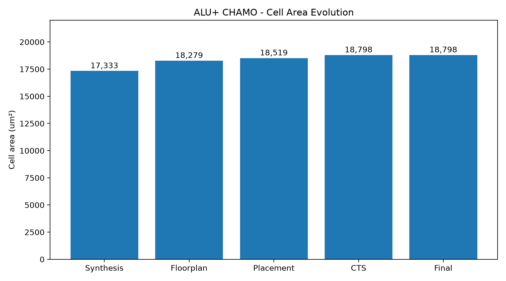
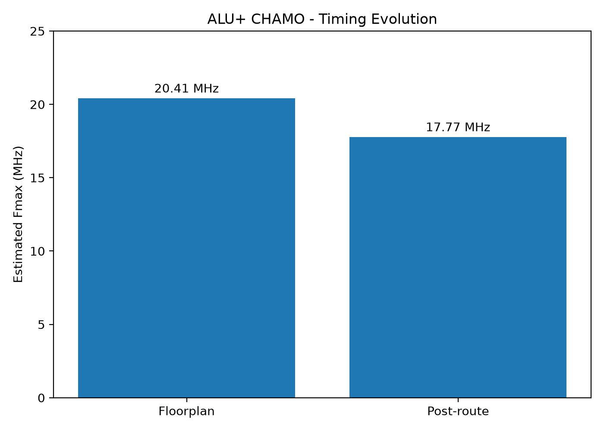
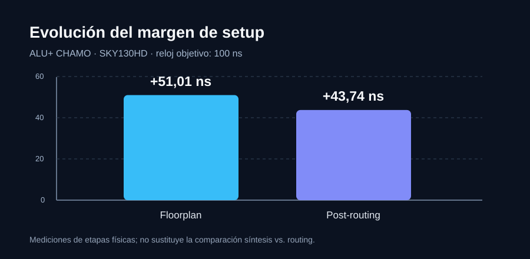

# Informe técnico de verificación — ALU+ CHAMO

**Diseño:** ALU+ de 16 bits, SystemVerilog, SKY130HD y OpenROAD Flow Scripts (ORFS).

**Alcance:** informe breve de los datos publicados y de las verificaciones ejecutadas. Se distingue entre mediciones realizadas, inferencias de RTL y análisis todavía pendientes. Los reportes completos de OpenROAD se conservan localmente; el repositorio público incluye artefactos finales y capturas, pero no logs de ejecución.

## 1. Descripción RTL y operaciones

El módulo combinacional `alu_plus` tiene un parámetro `WIDTH=8` y admite instancias superiores. La implementación física usa `WIDTH=16` dentro de `alu_plus_16`; se verificaron también configuraciones funcionales de 8 y 32 bits.

| ALUControl | Operación | Observación |
|:--:|:--|:--|
| 000 | AND | Entradas aisladas cuando no se selecciona |
| 001 | OR | Entradas aisladas cuando no se selecciona |
| 010 | ADD | Sumador CLA |
| 011 | SLT | Comparación con signo, reutiliza el CLA |
| 100 | Cero/reservado | No se implementa multiplicador: CHAMO requiere divisor |
| 101 | DIV | División entera sin signo |
| 110 | MOD | Residuo sin signo |
| 111 | ZERO | Todos los bits a cero |

El CLA está compuesto por grupos de hasta cuatro bits con propagación y generación del acarreo. El divisor *restoring* es combinacional: el bucle de `WIDTH` iteraciones se despliega en hardware durante la síntesis. El diseño síncrono tiene registros de operandos/control y registros de resultados y banderas, con dos flancos de latencia observable.

Las banderas son `N=Result[WIDTH-1]`, `Z=(Result==0)`, `C` y `V` significativas para ADD/SLT, y `div_by_zero` para DIV/MOD. La división por cero usa la convención documentada de cociente todo unos y residuo igual al dividendo.

## 2. Simulación y cobertura

- Regresión combinacional Verilator 5.053: **1 656 vectores PASS** para cada ancho 8, 16 y 32 bits (**4 968 PASS** en total). Son pruebas dirigidas y aleatorias; no constituyen una demostración exhaustiva.
- Simulación síncrona: DIV `20/3 = 6`, MOD `20%3 = 2`, y propagación `valid_in → valid_out`. Captura: [DIV/MOD](screenshots/01_simulation/div_mod_waveform.png).
- Simulación de triestado independiente con Icarus Verilog: `A=AA`, `B=0F`, AND `0A`, OR `AF`, y buses `Z` deshabilitados. Captura: [triestado](screenshots/01_simulation/tristate_waveform.png).

**Limitación importante:** el `tristate_demo.sv` no se sintetizó como parte del ASIC. `alu_plus.sv` usa aislamiento de operandos, lo que no corresponde a un bus de alta impedancia interno físico.

## 3. Síntesis y mapeo tecnológico

El RTL se sintetizó mediante Yosys/ORFS para biblioteca SKY130HD. La netlist tecnológica de síntesis se entrega como [ALUplus_CHAMO_synthesis.v](../deliverables/ALUplus_CHAMO_synthesis.v) y la final como [ALUplus_CHAMO_postroute.v](../deliverables/ALUplus_CHAMO_postroute.v).

El mapeo descompone el CLA, comparadores, restadores, multiplexores y lógica de banderas en celdas estándar. El divisor combinacional puede generar una red relativamente profunda; **no se afirma que todas las celdas o rutas provengan de un bloque concreto sin un análisis de trazabilidad por submódulo**.

**Área mapeada reportada:** 17 332,87 µm², área de celdas, no área del die.

## 4. Flujo físico y área

| Etapa | Área de celdas |
|:--|--:|
| Síntesis | 17 332,87 µm² |
| Floorplan | ≈18 279 µm² |
| Placement | ≈18 519 µm² |
| CTS / implementación final | ≈18 798 µm² |

El cambio entre síntesis y final es ≈8,45 %. Al incorporar buffers y realizar optimizaciones físicas, el área de celdas puede aumentar. No se debe atribuir todo el incremento a una causa única sin reportes detallados por tipo de celda.

## 5. Timing y ruta crítica

**Restricción:** `create_clock -period 100` ns (objetivo 10 MHz). Las siguientes cifras corresponden a reportes de etapas físicas, no al STA posterior inmediato a la síntesis.

| Magnitud | Floorplan | Post-routing |
|:--|--:|--:|
| Slack de setup | +51,01 ns | +43,74 ns |
| Período mínimo estimado | 48,99 ns | 56,26 ns |
| Fmax estimada | 20,41 MHz | 17,77 MHz |

**Camino crítico final de setup:** inicio `dut.b_q[0]`, destino `dut.Z`; llegada 56,52 ns; requerido 100,26 ns; slack +43,74 ns. Este camino muestra la influencia de la lógica de bandera cero en el período mínimo.

**Camino de hold más exigente:** `dut.valid_q` → `dut.valid_out`; slack +0,35 ns.

### Comparación síntesis frente a routing: aún no medida

El repositorio contiene `deliverables/ALUplus_CHAMO_synthesis.v` y `deliverables/synthesis.sdc`, pero **no contiene un reporte de STA de síntesis obtenido con una biblioteca Liberty identificada y condiciones reproducibles**. Por tanto, no se publica un slack ni una Fmax de síntesis inventados.

Se añade `scripts/run_sta_synthesis.sh` junto a `scripts/sta_synthesis.tcl` para generar una línea base antes de placement usando la Liberty elegida. Este STA puede omitir o simplificar parasitismos de interconexión y considera un reloj ideal, de modo que **su comparación con el post-routing es descriptiva y no una comparación física bajo condiciones idénticas**. La medición resultante debe verificarse antes de incorporarse a las tablas.

## 6. Revisión de SDC y reset

Archivos publicados: [SDC de síntesis](../deliverables/synthesis.sdc), [SDC final](../deliverables/final.sdc) y [SDC de entrada ORFS](../physical/orfs/constraint.sdc).

- El reloj está definido a 100 ns y existen retardos de entrada y salida de 2 ns para los puertos de datos/control.
- El SDC final incluye `set_propagated_clock`; el de síntesis no. Esta diferencia responde a la propagación física del reloj, por lo que la comparación temporal requiere explicitar modelos y esquinas.
- `rst_n` es un reset asíncrono activo bajo y no aparece en la lista de retardos de entrada. Esto **no demuestra por sí solo una violación**; indica que deben revisarse explícitamente cobertura STA, recuperación/remoción, liberación sincronizada del reset y excepciones apropiadas para el sistema.
- No se modificó retrospectivamente la restricción que generó el GDSII, pues alterarla sin reejecutar y verificar el flujo invalidaría la trazabilidad de los resultados publicados.
- Las cifras de setup/hold corresponden a las condiciones analizadas, no a verificación multicorner exhaustiva.

## 7. DRC, LVS y entregables

- DRC final reportado: **0 violaciones**.
- LVS final: **netlists coincidentes**.
- Routing detallado: **0 violaciones finales reportadas**.
- GDSII, OpenDB, netlist final, netlist de síntesis y SDC se publican en [deliverables](../deliverables).

Estas verificaciones corresponden a las reglas y modelos utilizados y no sustituyen certificación industrial para fabricación.

## 8. Reproducibilidad y límites

Los RTL están en `rtl/`; testbenches en `tb/`; scripts de compilación y síntesis en `scripts/`; configuración de ORFS en `physical/orfs/`. La ejecución física publicada se realizó con herramientas abiertas y SKY130HD; **no** se ejecutaron Synopsys VCS, Verdi, DC o ICC2.

**Pendientes medibles:** ejecutar STA de síntesis con Liberty identificada, adjuntar resumen de ese resultado, comprobar el tratamiento completo del reset y, si el docente exige cumplimiento literal, obtener aceptación expresa de las sustituciones de triestado interno y herramientas Synopsys.
